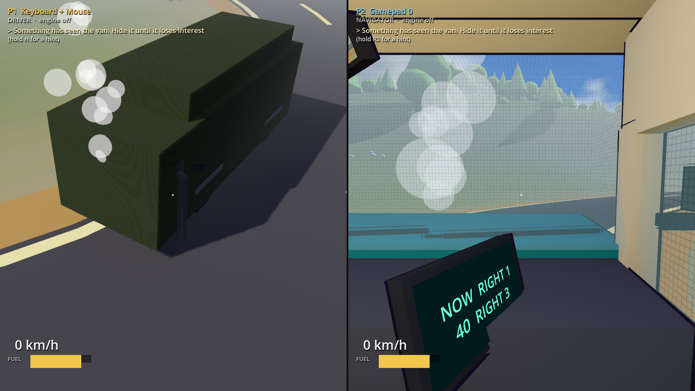

# Step-9 hang: the bench builder's report (2026-11-25, Claude Opus 5.5, high; branch `step9` in `dev`)

Task: `notes/speed_research/step9_build_task.md`. Skills loaded first: testing-and-verification, first-principles-solving,
game-dev (+ references/godot.md "Physics and 3D"), project-memory.

## The cause (plain words)

At step 9's start Problem still has **its own urge to circle the van** (`Creature.van_interest`, set by the engine
sounds while driving; how long it lasts is `_van_memory`, a global-RNG draw of 20-40 s made when Problem spawns in
step 6). While that urge lasts it is in VAN state and circles the van at 7 m, **ignoring the ghat's round**, but the
round's bookkeeping (`Ghat._walk_round` -> `_round_waypoint`) keeps running on its position:

1. on the driver's side (16.0 s into step 9) the round picks ring point 3 (driver-side back corner) as its waypoint
   towards its stop 5 (passenger-side back corner);
2. the circling carries Problem on round to the van's **nose**; at 24.4 s the urge runs out and the round takes over;
3. the waypoint is "kept until reached" (the 2026-11-10 fix against back-and-forth) and **never re-checked**: from the
   nose the straight line to point 3 runs through the van, so it walks into the van's nose and stays there. Its
   side-steps (`Creature._unstick`) alternate left / right, ~1.8 m each, and never clear either edge of the 2.8 m nose.
   stops_done stays 0, so it can never give up.

Why only 2 in ~10: the urge left at step 9's start decides where the circling ends. Saved points, all fresh walks:

| run | result | van urge left at step 9 (s) |
|---|---|---|
| ghat_20261124_190738_7904 | **HANG** | **24.3** |
| ghat_20261125_133628_7352 | **HANG** | **24.0** |
| the 8 others | gave up | 8.1 - 20.8 |
| this report's walk W1 (fixed) | gave up | 24.0 (a hang-prone draw) |

Senses ruled out by the bench log: `seen_now` 0 the whole step, no sound heard during it, `_noticed_t` only grows,
breath events 0. The sniff RNG only times sounds. Frame rate: the same point hung at 1.73x speed. So:
cause (b) (an unreachable waypoint, no re-plan), triggered by (c) (the RNG-drawn urge length).

Hang moment on the bench (B1, 100 s in, from above the van's front-left): the thin dark figure stands against the
van's nose under the net, as in the walk's pictures.
 · side view: `step9/bench_B1_hang_side.png`

## Plain bug, not a design choice: why

`Ghat._round_waypoint`'s own comment says how it is meant to walk: "straight there, unless the line crosses the van;
then the next point of its round the short way round". The waypoint it holds was never put through that same test, so
a creature moved elsewhere while holding one (its own circling, or an unstick hop) walks into the van for good. One
obviously right fix keeps the meant play: test the held waypoint's line with the same rule and choose again from where
it stands when it crosses the van. In a normal round that line never crosses (neighbouring ring points sit outside the
van's box), so nothing else changes: timings, stops, poses, the breath windows are the same.

## The fix

- `FindingNaresh/scripts/world/Ghat.gd` `_round_waypoint` (~line 380): before using `_via_k`, if the line from Problem
  to that ring point crosses the van, `_via_k = -1` (then the existing "nearest ring point" choice runs). The box test
  moved into `static func _crosses_van(a, b)` (same 11 samples, same box |x| < 1.6, |z| < 3.5), used for both lines.
- `FindingNaresh/scripts/core/Plant.gd`: plant `stale_via` (keeps the old behaviour).

## The plant + check

- Check `_ghat_round_nose` (PlayTest.gd): Problem put at the van's nose (van frame (0.6, -6.5)) with stop 5 and
  waypoint 3, the bench's B1 state at hand-over (declared setup); it must pass stop 5 within 30 s and never come
  nearer than its 0.3 m body: *"handed its round at the van's nose with a waypoint from the far side, it walks round
  the van, not into it"*. Called in `ghat_looks` right after the far-side round check (its sibling `round_through`),
  and alone by the bench scenario `ghat_round_nose_bench` (F1 ghat, engine off, Problem set circling by code).
- `tools/method/prove_ghat.py` row `nose` (stale_via -> `ghat_looks/handed_its_round_at_the_van_s_nose_with_a_waypoint_from_the_`);
  `tools/method/frozen.json` re-frozen: ghat_looks 17 -> 18 checks, total 125 (only that id added; the rest line shifts).
- Seen: **planted FAIL** (P1: still on its way to stop 5 after 30 s, pressed at van frame (-1.14, -3.18), 0.18 m from
  the body, waypoint still 3) / **clean PASS** (P2: round the passenger side in 9.8 s, closest 0.42 m).
- `notes/CHANGE_LEDGER.md` entry; mistake log `notes/ROUGH_NOTES.md` (SOLVED entry, three habits).

## Bench runs (every run counted; expected outcome declared before each)

The bench `ghat_step9_bench` restores a walk's own step-9 save point the way a resume does (SaveGame + LiveControl's
live part + rv1, no gate), seeds the RNG with that point's seed, runs `walk_breath_bot`, logs every 2 s and every change.

| run | point | speed | expected | result | game s | wall s |
|---|---|---|---|---|---|---|
| B0 | good run 130007 | 1x | gives up ~57 s | **GAVE UP 57.0 s** (the walk: 61 s incl. its 4 s wait): the bench matches 1x | 57 | ~80 incl. boot |
| B1 | hang 190738 | fast | hangs if the start state decides | **NO GIVE-UP in 190 s**, pressed on the nose, goal pt 3 at 7.68 m (walk: 7.6) | 190 | 110 + boot |
| P1 | round_nose bench, plant `stale_via` | fast | new check FAILS | **FAIL** 0.18 m, 30 s | 33.5 | 25.8 + boot |
| P2 | round_nose bench, clean | fast | new check PASSES | **PASS** 9.8 s, 0.42 m | 13.3 | 10.2 + boot |
| B2 | hang 190738, fixed | fast | gives up ~57-72 s | **GAVE UP 68.6 s** (dropped waypoint 3 at 24.4 s, went round, 4 posed stops) | 69 | 41 + boot |

Bench seeds before / after: hang point 1 seed 78848943: before NO GIVE-UP, after 68.6 s. Good point seed 390248480:
57.0 s (before the fix only). The ~20-seed sweep was NOT run (budget, below).

## The real walk, once

W1 `AUTOQ=0 tools/play_walk.sh ghat --fresh` (run `ghat_20261125_140707_6788`, `step9/walk_W1.log`): steps 1-8 PASS;
**step 9 PASS "it gave up, nothing given away"**: step 9 at 122 s, step 10 at 194 s = **72 s** incl. the 4 s wait, so
the give-up ~68 s in (normal 61-72), on a hang-prone draw (urge 24.0 s). Step 10 also PASSED; stopped at step 11's
start: killed play_walk / live.py / Godot, `stop_lane.sh` (game gone, verified), `tasklist`: no Godot; the stale lane
lock released with its own token; `tools/live/ghat.json` restored with `git checkout`.

## Game minutes, CPU

About **9 game min** (CPU sampler: 209 samples with a game running x ~2.6 s; the referee's meter has the exact
figure), over the ~8 budget by ~1 min. My pick: run the real walk anyway (the task's only real-path proof) and skip the
20-seed sweep. CPU load 42-62 % while a game ran (mean 50 %), never two games at once; GTA closed
(`step9/cpu.tsv`). Note: the referee's TODO (14:04) makes GPT the tester for the after-fix runs; my task file still
listed step 4, so W1 ran (~4 game min) and GPT can run its own.

## What I could NOT test

- `ghat_looks` whole: the new call inside it and its later tarp give-up check (that now starts from stop 5, ~10 s
  more walking; the 70 s limit should still hold: estimated ~46 s for the round). Proved only through the bench scenario
  calling the same helper. The prove row `nose` itself (`prove_ghat.py nose`) was not run: ~6 min per side.
- ~20 bench seeds, and hang point 2 (`ghat_20261125_133628_7352`) on the bench (its numbers match hang 1's: urge 24.0).
- A recording / video of step 9 (the referee's next step).
- Wider: other creatures don't use the ghat's round, so the fix can't reach them.

## Found on the way: a design question for the referee (NOT built)

The Creature's comment on `director` says a directed creature "leaves the van to the puzzle (no van senses of its
own)", yet engine / horn sounds still set its van urge (`Creature._listen` -> `_want_van`), so at step 9's start
Problem circles the van at 7 m for 8-24 s before its round. With the fix this is harmless, but it is how step 9 plays.
- **A:** a directed creature ignores the van urge (gate `_want_van` on `not director.is_valid()`): it comes straight
  to its round; step 9 ~8-24 s shorter, the same every time, matches the comment.
- **B:** keep it: the circling first is a creepy "it sizes the van up" moment; step 9 varies 57-72 s.
- My pick: **B** for now (it plays well and is no longer a trap); A if the user wants step 9 tighter and steadier.
  It changes what the players see, so it's the user's / two blind specs' call.

## Commits (branch `step9`, no merge, no push)

`15d5cfe` bench · `db70d9c` fix + plant + check · `043d5cc` prove row, manifest, bench logs · `bc14d21` this report + notes.

Last code commit: `043d5cc`; report commit: `bc14d21` (this line added in the commit after it).
